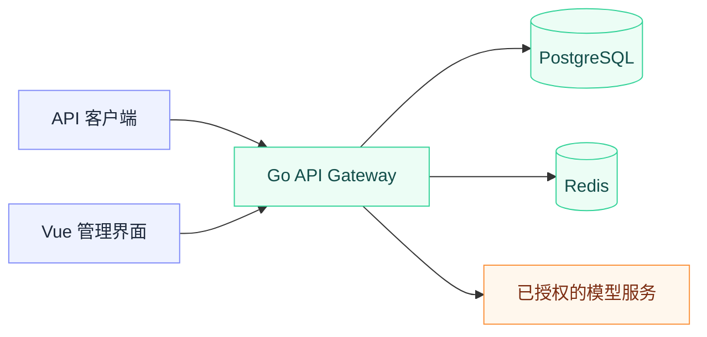

<div align="center">


# sub2apipro

Sub2API 维护副本 · AI API 网关与自托管部署。


[本仓库定位](#本仓库定位) · [部署与使用](#部署与使用) · [来源与差异](#来源与差异) · [原英文文档](./README_UPSTREAM.md) · [中文文档](./README_CN.md) · [日本語](./README_JA.md)

</div>

本仓库保留 Sub2API 项目的代码与文档，并承载本地维护改动。项目包含 Go 后端、Vue 前端、PostgreSQL 和 Redis 等组件，面向模型 API 接入与额度分配场景。

这里不是上游官方仓库，也不因仓库名包含 `pro` 就宣称具备额外的商业授权、服务保证或已经验收的企业级能力。

## 本仓库定位

| 范围 | 说明 |
| --- | --- |
| 当前上游 | [ranxi2001/sub2api](https://github.com/ranxi2001/sub2api)，生产分支 `production` |
| 当前副本 | [alanbulan/sub2apipro](https://github.com/alanbulan/sub2apipro)，默认分支 `main` |
| 使用资料 | [中文](./README_CN.md)、[原英文](./README_UPSTREAM.md)、[日本語](./README_JA.md) |
| 本仓库变更 | [提交记录](https://github.com/alanbulan/sub2apipro/commits/main) |
| 许可与限制 | 保留仓库中的原有许可、署名和上游使用提示，不在本页重新授权 |

## 部署与使用

使用本副本时，克隆当前仓库，而不是无意间切换回上游源码：

```sh
git clone https://github.com/alanbulan/sub2apipro.git
cd sub2apipro
```

新人部署、官方版替换、Excel / BPS 配置和质量运维步骤，请阅读[新人入门文档](docs/新人入门.md)。

账号检测、失败处置和自动恢复，请阅读[质量运维](docs/account-quality-operations.md)；BPS OAuth 登录、工具兼容和 403 恢复配置，请阅读[Excel / BPS 协议](docs/excel-bps.md)。

Mihomo 支持从订阅节点或动态代理单条、批量添加为静态代理，再给账号分别选择固定节点，详见[操作说明](docs/mihomo-static-node-proxies.md)。

已经托管账号或完成部署，想在 Codex 中使用？请阅读[新人入门：使用 Sub2API 接入 Codex](docs/新人入门-使用Sub2API.md)，按步骤创建 API Key、配置 Cockpit Tools 并验证调用。


## 本仓库的维护方向

本副本跟踪 `ranxi2001/sub2api` 的 `production` 分支，并保留本地主题、界面文案和同步流程。上游维护的功能方向包括：

- **DeepSeek 与 Codex 适配**：支持 Responses 到 Chat Completions 的转换、工具调用历史和上下文压缩兼容。配置模型映射后，可通过切换 API Key 分组使用 DeepSeek，沿用客户端配置。[操作教程](https://tosky.io/docs/?doc=deepseek-switch-group)
- **账号质量运维**：维护定时答题检测、判题记录、失败处置和自动恢复，支持按模型隔离及全部检测模型失败时移出指定分组。检测结果以实际回答和判题证据为准，不以票据形态判断质量。
- **Mihomo 出口管理**：维护订阅、动态代理、节点状态和账号业务出口；支持从订阅节点或动态代理单条、批量添加为静态代理，再给账号分别选择固定节点。[操作说明](docs/mihomo-static-node-proxies.md)
- **Excel / Basispoints**：维护模型级 BPS 路由、内嵌图片 HTTPS 中转、磁盘和并发保护、结构化输出校验，以及工具历史和 transport 恢复。路由遵循账号与模型配置；不支持的托管工具可按策略回退原生 Codex，或保持 BPS 并省略工具，具体边界见 [BPS 配置说明](docs/excel-bps.md)。
- **上游修复维护**：持续跟踪上游 Codex、Responses、工具调用、密文恢复和限流修复；先确认与本 fork 的行为差异，再按提交级别移植并补充回归测试。
- **发布与升级**：上游 Release、安装资源和容器镜像来自 `ranxi2001/sub2api`，版本变更见 [更新说明](https://github.com/ranxi2001/sub2api/releases)。本副本由自己的 CI 验证与发布；上游产物不保证包含本地修改，Release 成功也不代表生产服务已经部署。

贡献代码时，请在独立分支中说明影响的请求路径、账号类型、配置默认值和兼容边界。涉及生产分支的修复应先进入原 PR head，通过 CI 后再合并；不要提交 Token、OAuth 导出、ticket、代理凭据或生产配置。

## 项目概述

Sub2API 是一个 AI API 网关平台，用于分发和管理 AI 产品订阅的 API 配额。用户通过平台生成的 API Key 调用上游 AI 服务，平台负责鉴权、计费、负载均衡和请求转发。

## 核心功能

- **多账号管理** - 支持多种上游账号类型（OAuth、API Key）
- **API Key 分发** - 为用户生成和管理 API Key
- **精确计费** - Token 级别的用量追踪和成本计算
- **智能调度** - 智能账号选择，支持粘性会话
- **并发控制** - 用户级、账号级和 API Key 级并发限制，支持可配置的 Key 等待队列
- **速率限制** - 可配置的请求和 Token 速率限制
- **内置支付系统** - 支持 EasyPay 易支付、支付宝官方、微信官方、Stripe，用户自助充值，无需独立部署支付服务（[配置指南](docs/PAYMENT_CN.md)）
- **管理后台** - Web 界面进行监控和管理
- **外部系统集成** - 支持通过 iframe 嵌入外部系统（如工单等），扩展管理后台功能

### 首次初始化管理员

全新自动安装时，`ADMIN_EMAIL` 和 `ADMIN_PASSWORD` 留空会生成随机登录邮箱和密码，可从首次启动日志中的 `Generated admin` 获取。显式指定时，邮箱必须符合登录格式，密码必须为 8–72 字节。已有管理员或已有用户的部署跳过创建与此项校验。详细配置见 [部署说明](deploy/README.md)。

## API Key 并发等待队列

当 API Key 设置了大于 `0` 的 `concurrency_limit` 时，达到上限后的新请求会在原连接上等待空闲槽位。默认值 `0` 不增加 Key 级并发限制。等待策略是全局配置，进程启动时读取：

```yaml
gateway:
  api_key_queue:
    max_waiting: 5
    timeout_seconds: 30
```

| 环境变量 | 默认值 | 说明 |
|----------|--------|------|
| `GATEWAY_API_KEY_QUEUE_MAX_WAITING` | `5` | 每个受限 Key 允许额外等待的请求数；`0` 关闭 Key 排队。 |
| `GATEWAY_API_KEY_QUEUE_TIMEOUT_SECONDS` | `30` | 单个请求最长等待秒数，必须为正整数。 |

- 等待名额按 Key 独立计算，不保证 FIFO；`concurrency_limit: 0` 的 Key 不进入队列。
- 队列用于 HTTP/SSE、OpenAI Responses WebSocket 每轮请求和 Live 创建的 Key 准入，与用户级、账号级等待限制独立。
- 等待期间复核 Key、用户及当前请求的模型/能力权限。Key 换组、平台或计费模式变化返回可重试的 `503` / `API_KEY_GROUP_CHANGED`。WebSocket 鉴权/权限失败以 `1008` 关闭，容量或临时服务错误以 `1013` 关闭。
- 关闭排队时达到上限返回 `429` / `gateway_concurrency_limit`；队列满返回 `429` / `api_key_queue_full`；等待超时返回 `429` / `api_key_queue_timeout`。
- 两个配置值必须为整数；负数、小数、非法字符串或超出范围会阻止启动。即使关闭排队，超时也必须为正数。
- 修改 Compose `.env` 后需要重建容器以更新环境变量。调大等待时间时，需要确认客户端及反向代理的首字节超时。
- 升级自动应用 `237_add_api_key_concurrency_limit.sql`，旧 Key 默认为 `0`。回退二进制不会撤销数据库新增字段。

### 中转 API Key 的上游 429

- OpenAI 平台普通 API Key 收到上游 429 时，使用管理端已有的“429 兜底冷却”设置（默认启用、5 秒），不再把透传的 ChatGPT/Codex 周窗口、`resets_at` 或使用率快照写成整个 Key 的配额状态。关闭该设置时不新增本地兜底冷却，上游错误仍按原有响应与故障转移逻辑处理。
- OAuth / Setup Token 保留真实配额窗口；Ollama Cloud、国产供应商和 OpenCode Go 的已识别专用配额逻辑，以及池模式、自定义错误策略和显式临时停调规则，仍按原有优先级处理。
- 管理端测试 API Key 时，不再用透传的 ChatGPT 429 重置时间更新 Key 的调度状态。升级不会自动清理此前已写入的长冷却；核实状态后可使用管理端恢复功能处理。


之后按照[中文部署文档](./README_CN.md)或[完整英文文档](./README_UPSTREAM.md)核对环境、安装方式、数据存储和配置。镜像、二进制、一键安装脚本可能指向上游发布渠道；使用前检查来源，不能假设它们包含本副本的独立修改。

## 技术栈

| 组件 | 技术 |
|------|------|
| 后端 | Go 1.27.3, Gin, Ent |
| 前端 | Vue 3.4+, Vite 5+, TailwindCSS |
| 数据库 | PostgreSQL 15+ |
| 缓存/队列 | Redis 7+ |
| API 协议 | OpenAI Responses / Chat Completions、Anthropic Messages、Gemini、SSE、WebSocket |
| 调度与可靠性 | 粘性会话、并发控制、限流、故障转移、模型隔离与冷却 |
| 观测与运维 | 结构化日志、请求分段耗时、健康检查、Mihomo 出口与 systemd |
| 交付与质量 | Docker Compose、GitHub Actions、Go 单元测试、前端类型检查与构建 |



该图说明组件关系，不是对生产可用性、吞吐量或账号安全的测试结论。接入凭据只应存放在适当的 Secret 或受保护配置中，不提交到 Git。

欢迎围绕协议兼容、账号调度、质量运维、支付计费、管理后台和运维观测提交改进。高质量贡献应尽量保持边界清晰，并在 PR 中说明请求路径、状态变化、兼容性影响和验证证据。

## 来源与差异

GitHub 是否显示 Fork 标记不能代替代码来源说明。本仓库的原 README 使用 Sub2API 名称，并指向上游项目；原有内容已完整保留在根目录的 [README_UPSTREAM.md](./README_UPSTREAM.md)，原相对链接的基准不变。

本次整理前，`main` 的提交为 `a93fa9d34d70032bab15089cab697803e7d39348`，其中记录了远程 ref 查询错误时保留同步检查点的修复。这个 SHA 是**本仓库整理前快照**，不是已经核实的上游同步基线。

不能把本副本描述为与上游零差异或实时同步。合并上游更新前应核对基线、独立提交、配置与数据库迁移，并保留回滚路径。

## 使用与验证边界

上游的重要提示仍然适用，包括服务条款风险、合规使用、责任声明和商业授权相关说明；完整措辞保留在[原文档](./README_UPSTREAM.md)。本页不改变这些条款，也不把原文档中的赞助、价格或推广内容作为本副本的质量证明。

本次仅整理文档与来源导航，没有修改 API、路由、计费、数据迁移、同步程序或供应商配置，也没有执行生产部署和模型调用验收。
